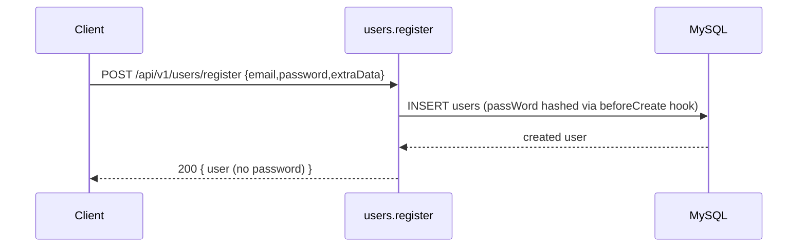
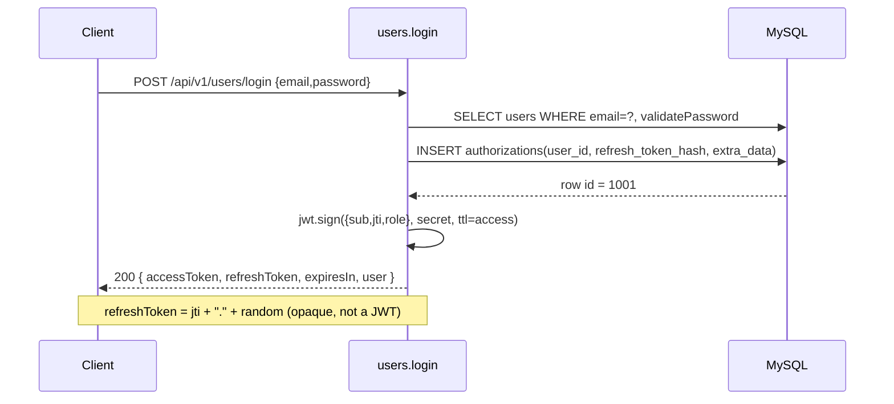
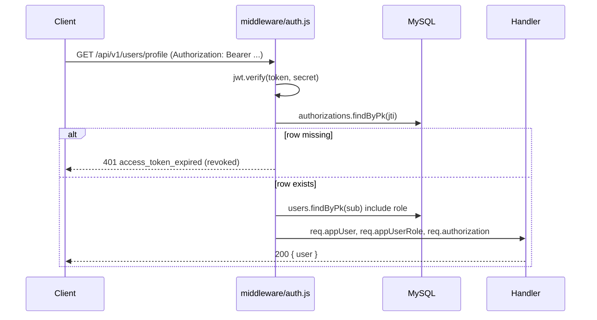
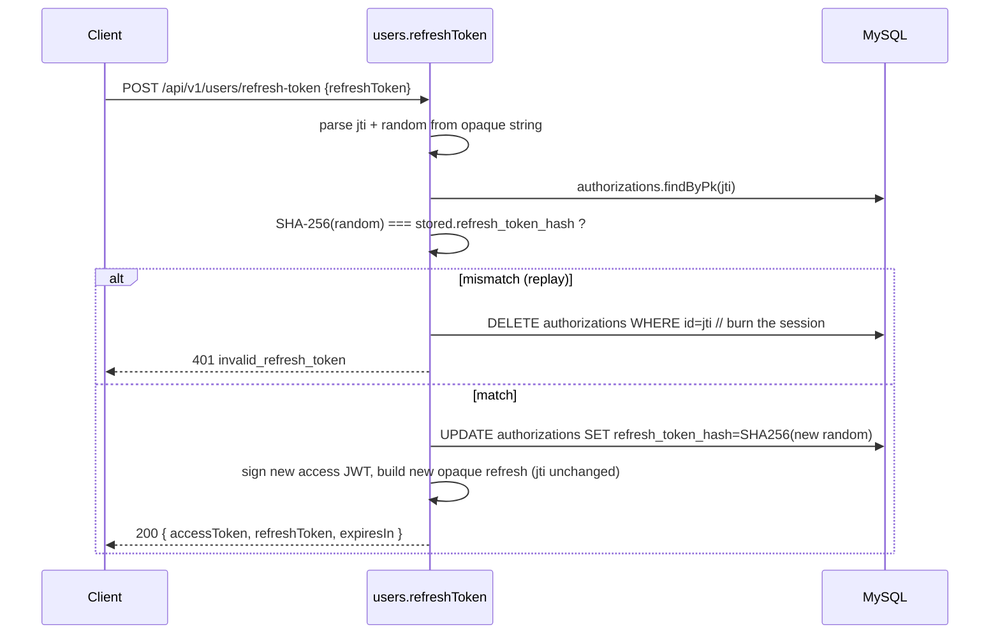
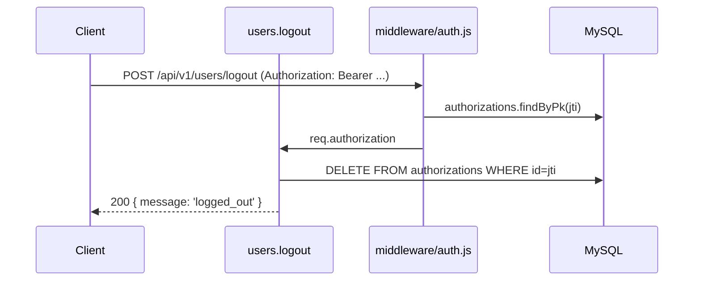

# Authentication

JWT (HS256) for transport. One row per active session in `authorizations`. Logout = delete the row. Refresh = rotate the row's `refresh_token_hash` and issue a fresh access JWT.

## Tokens

### Access JWT

- Algorithm: `HS256`.
- Signing key: `process.env.JWT_SECRET` (must be 32+ chars; boot fails otherwise).
- TTL: `process.env.JWT_ACCESS_TTL` (default `15m`).
- Payload:

  ```json
  {
    "sub": 42,        // users.id
    "jti": 1001,      // authorizations.id (used for revocation)
    "role": "user",
    "iat": 1745740800,
    "exp": 1745741700
  }
  ```

- Header:

  ```
  Authorization: Bearer <jwt>
  ```

  For backward compatibility with the source codebase the middleware also accepts `?nekot=<jwt>` as a query parameter.

### Refresh token (opaque)

The refresh value is **not a JWT** in v0.1. It is a string:

```
<authorizations.id>.<randomBase64url>
```

- The first segment is the `jti` used in the access JWT and in `authorizations.id`.
- The second segment is high-entropy random bytes (URL-safe), generated per login/rotation.
- The server stores only `SHA-256(<randomBase64url>)` in `authorizations.refresh_token_hash` (the full string is never stored). Presenting a valid pair proves possession of the current refresh secret; rotation invalidates the previous random segment.
- There is no separate time-based `exp` on the refresh string; the session ends on logout, replay burn, or row delete. A future version may add `expires_at` on `authorizations` or a signed refresh segment.

### Why a `jti` + DB row

Pure JWT is stateless — you cannot revoke tokens before their `exp`. By adding a `jti` claim that points at an `authorizations` row, the server can invalidate any session by deleting the row. The cost is one PK lookup per authenticated request.

## Flows

### Register



### Login



### Authenticated request



### Refresh



Rotation defends against refresh-token theft: replay of the old refresh token after a successful rotation triggers session burn.

### Logout



After this, every JWT containing `jti=1001` returns 401 even if its `exp` is still in the future.

## Role gate

`auth_checker.js` is the role authorisation middleware. Mount it after `auth.js` in routes that need a specific role.

```js
// src/modules/users/routes/users.js
const authChecker = require('../../../../middleware/auth_checker');
routes.post('/list', authChecker('admin'), userController.listUsers);
routes.post('/profile', authChecker('admin,user'), userController.getProfile);
```

`authChecker(access)` accepts a comma-separated allow-list. If `req.appUserRole` is not in the list, the request is rejected with 403.

## Password hashing

Passwords are stored as **bcrypt** hashes in `users.passWord` (via `db/sequelize/hooks.js` and `hashPassword` on the model). Cost factor 10; raise in a coordinated release if you need stricter work factors.

For importing legacy **SHA-1** rows from the old base project, see [security.md](security.md) ("Migrating users from a legacy SHA-1 database").

## Env vars

| Var | Required | Default | Notes |
| --- | --- | --- | --- |
| `JWT_SECRET` | yes | — | 32+ chars. Boot fails fast if missing or short. |
| `JWT_ACCESS_TTL` | no | `15m` | jsonwebtoken-compatible string (e.g. `15m`, `1h`, `3600`). |
| `JWT_ISSUER` | no | `starter` | optional, written into `iss` claim if set. |
| `JWT_AUDIENCE` | no | — | optional, written into `aud` claim if set. |

## Common error responses

| Code | Reason | When |
| --- | --- | --- |
| 401 `access_token_expired` | JWT past `exp`, OR `authorizations` row deleted (revoked / logged out). | every authenticated route |
| 401 `invalid_token` | JWT signature mismatch or malformed. | every authenticated route |
| 401 `invalid_refresh_token` | refresh JWT not of `type=refresh`, or hash mismatch. | `/refresh-token` |
| 403 `forbidden` | role not in `auth_checker(...)` allow-list. | role-gated routes |
| 423 `account_locked` (future) | too many failed login attempts in window. | `/login` |

## Testing the auth flow

The Jest suite in `tests/integration/users.*.test.js` exercises every step:

- `users.register.test.js` — happy path register.
- `users.login.test.js` — login returns valid JWT pair, `authorizations` row exists.
- `users.profile.test.js` — `/profile` requires JWT; rejects malformed / expired tokens.
- `users.refresh.test.js` — refresh rotates, replay of old refresh is rejected.
- `users.logout.test.js` — logout removes `authorizations` row, profile returns 401.

Run: `npm test`.
