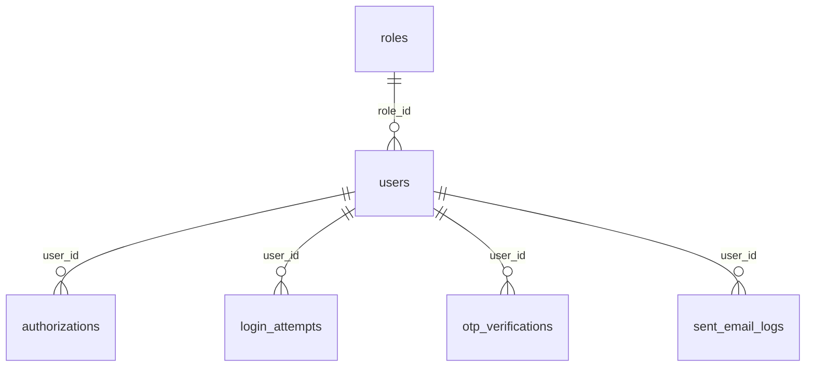

# Database

MySQL 8 (or 5.7 with JSON support). InnoDB engine, `utf8mb4` charset throughout.

All tables share three audit columns added by Sequelize via the global `define` block in [config/config.json](../config/config.json):

- `created_at DATETIME` — auto-set on insert.
- `updated_at DATETIME` — auto-set on every update.
- `deleted_at DATETIME NULL` — paranoid soft-delete. Default scope filters out rows with `deleted_at IS NOT NULL`.

All tables also include a `extra_data JSON NULL DEFAULT NULL` column. See [extra-data.md](extra-data.md) for the policy.

## ERD



## Tables

### `roles`

RBAC lookup table. Seeded at install time.

| Column | Type | Constraints | Notes |
| --- | --- | --- | --- |
| `id` | INT UNSIGNED AUTO_INCREMENT | PK | join key |
| `role_name` | VARCHAR(64) | NOT NULL, UNIQUE | `admin`, `user`, ... |
| `extra_data` | JSON | NULL DEFAULT NULL | description, permissions |
| `created_at` / `updated_at` / `deleted_at` | DATETIME | | standard |

Seed rows (run once, idempotent via `INSERT IGNORE`):

```sql
INSERT IGNORE INTO roles (id, role_name, extra_data) VALUES
  (1, 'admin', JSON_OBJECT('description','Full administrator','permissions',JSON_ARRAY('users.manage','roles.manage','settings.write'))),
  (2, 'user',  JSON_OBJECT('description','Default end user','permissions',JSON_ARRAY('users.self.read','users.self.update')));
```

Sample row:

```json
{
  "id": 1,
  "role_name": "admin",
  "extra_data": {
    "description": "Full system administrator",
    "permissions": ["users.manage", "roles.manage", "settings.write"],
    "isSystem": true
  }
}
```

### `users`

Primary identity table. Email is the login key; `passWord` is stored with **bcrypt** (via `bcryptjs`) in hooks on create/update. See [security.md](security.md) for rotation and production notes.

| Column | Type | Constraints | Why a real column |
| --- | --- | --- | --- |
| `id` | BIGINT UNSIGNED AUTO_INCREMENT | PK | |
| `role_id` | INT UNSIGNED | NOT NULL, FK → `roles.id`, DEFAULT 2 | RBAC join + filter |
| `email` | VARCHAR(128) | NOT NULL, UNIQUE | login lookup |
| `passWord` | VARCHAR(128) | NULL | bcrypt hash. Field name `passWord` kept to match the source codebase. |
| `status` | ENUM('pending','active','inactive') | NOT NULL DEFAULT 'pending' | active-user filter |
| `extra_data` | JSON | NULL DEFAULT NULL | name, phone, profile, reset tokens, otp counter, prefs |
| `created_at` / `updated_at` / `deleted_at` | DATETIME | | |

Hooks: `beforeCreate` and `beforeUpdate` bcrypt-hash `passWord` when it changes.

Sample row:

```json
{
  "id": 42,
  "role_id": 2,
  "email": "john.doe@example.com",
  "passWord": "$2a$10$...............................................",
  "status": "active",
  "extra_data": {
    "name": "John Doe",
    "phoneNumber": "+966501234567",
    "profileImage": "/uploads/1733481336314_rmeeqk8bxxn.jpeg",
    "resetPasswordToken": null,
    "resetTokenExpiry": null,
    "otpLimit": 0,
    "preferences": { "language": "en", "theme": "light", "notifications": true },
    "address": { "city": "Riyadh", "country": "SA" }
  }
}
```

### `authorizations`

Server-side session record. The row's `id` is the JWT's `jti` claim. Logout = delete the row. See [auth.md](auth.md).

| Column | Type | Constraints | Why a real column |
| --- | --- | --- | --- |
| `id` | BIGINT UNSIGNED AUTO_INCREMENT | PK | becomes JWT `jti` |
| `user_id` | BIGINT UNSIGNED | NOT NULL, FK → `users.id` ON DELETE CASCADE, INDEX | session lookup |
| `refresh_token_hash` | CHAR(64) | NULL | SHA-256 of the **random** segment of the refresh string (after the dot); see [auth.md](auth.md) |
| `extra_data` | JSON | NULL DEFAULT NULL | device, platform, app version, last seen |
| `created_at` / `updated_at` / `deleted_at` | DATETIME | | |

The signed access JWT is **not stored**. Only the row's existence (and matching `id`) acts as revocation.

Sample row:

```json
{
  "id": 1001,
  "user_id": 42,
  "refresh_token_hash": "8f9b1c2d3e4f56789012345678abcdef0123456789abcdef0123456789abcdef",
  "extra_data": {
    "deviceId": "iPhone-14-Pro-ABC123",
    "deviceToken": "fcm_xyz_push_token...",
    "platform": "ios",
    "appVersion": "1.0.3",
    "issuedAt": "2026-04-27T08:00:00.000Z",
    "lastSeenAt": "2026-04-27T09:12:00.000Z"
  }
}
```

Sample issued JWT payload (returned to client, never persisted):

```json
{
  "sub": 42,
  "jti": 1001,
  "role": "user",
  "iat": 1745740800,
  "exp": 1745741700
}
```

### `login_attempts`

Audit trail for login successes/failures. Used for rate-limit/lockout decisions.

| Column | Type | Constraints | Why a real column |
| --- | --- | --- | --- |
| `id` | BIGINT UNSIGNED AUTO_INCREMENT | PK | |
| `email` | VARCHAR(128) | NULL, INDEX | per-email failure count |
| `attempt_status` | ENUM('SUCCESS','FAILURE') | NOT NULL | filter for failures |
| `extra_data` | JSON | NULL DEFAULT NULL | userId, ip, userAgent, reason |
| `created_at` / `updated_at` / `deleted_at` | DATETIME | | composite index with email |

Index: `INDEX idx_login_email_time (email, created_at)`.

Sample row:

```json
{
  "id": 7,
  "email": "john.doe@example.com",
  "attempt_status": "FAILURE",
  "extra_data": {
    "userId": 42,
    "ip": "192.168.1.10",
    "userAgent": "Mozilla/5.0 (Macintosh) Chrome/124.0",
    "reason": "invalid_password"
  }
}
```

### `otp_verifications`

Short-lived OTPs for password reset / email verification.

| Column | Type | Constraints | Why a real column |
| --- | --- | --- | --- |
| `id` | BIGINT UNSIGNED AUTO_INCREMENT | PK | |
| `user_id` | BIGINT UNSIGNED | NOT NULL, FK → `users.id` ON DELETE CASCADE | scope OTP to user |
| `otp` | INT | NOT NULL | match on verify |
| `expires_at` | DATETIME | NOT NULL | TTL filter |
| `verified` | BOOLEAN | NOT NULL DEFAULT FALSE | filter unused codes |
| `extra_data` | JSON | NULL DEFAULT NULL | purpose, channel, attempt count |
| `created_at` / `updated_at` / `deleted_at` | DATETIME | | |

Index: `INDEX idx_otp_user (user_id, verified, expires_at)`.

Virtual fields on the model:

- `isPending` — true if `expires_at` is within 60 seconds of (now + 2 minutes). Used to throttle OTP resends.
- `isExpired` — true if `expires_at < now`.

Sample row:

```json
{
  "id": 15,
  "user_id": 42,
  "otp": 482917,
  "expires_at": "2026-04-27T08:10:00.000Z",
  "verified": false,
  "extra_data": {
    "purpose": "reset_password",
    "channel": "email",
    "requestIp": "192.168.1.10",
    "attempts": 0
  }
}
```

### `sent_email_logs`

Outbound email audit (each nodemailer send writes a row).

| Column | Type | Constraints | Why a real column |
| --- | --- | --- | --- |
| `id` | BIGINT UNSIGNED AUTO_INCREMENT | PK | |
| `user_id` | BIGINT UNSIGNED | NULL, FK → `users.id` ON DELETE SET NULL, INDEX | per-user history |
| `status` | ENUM('sent','failed') | NOT NULL | failure dashboards |
| `extra_data` | JSON | NULL DEFAULT NULL | recipient, subject, body, type, smtp response, template vars |
| `created_at` / `updated_at` / `deleted_at` | DATETIME | | |

Index: `INDEX idx_email_user_time (user_id, created_at)`.

Sample row:

```json
{
  "id": 3,
  "user_id": 42,
  "status": "sent",
  "extra_data": {
    "to": "john.doe@example.com",
    "subject": "Welcome to Starter",
    "body": "<html><body>Hello John</body></html>",
    "type": "welcome",
    "response": "250 OK id=<abc@smtp.gmail.com>",
    "templateVars": { "name": "John" }
  }
}
```

## Migrations workflow

For v0.1 migrations are a single flat SQL file: [db/migrations.sql](../db/migrations.sql). Apply with:

```bash
mysql -u <user> -p <db> < db/migrations.sql
```

When you change the schema:

1. Edit the corresponding model in `db/schemas/`.
2. Append a new `ALTER TABLE` (or `CREATE TABLE` for a new entity) to `db/migrations.sql`. Keep the file forward-only and idempotent (`CREATE TABLE IF NOT EXISTS`, `ALTER TABLE ... ADD COLUMN IF NOT EXISTS` where the engine supports it).
3. Update [database.md](database.md) in the same PR.
4. Add a sample row to the appropriate section of this doc.

For production rollouts beyond v0.1, replace the flat file with [Umzug](https://github.com/sequelize/umzug) (Sequelize-native migration runner). Tracked in [security.md](security.md) "Future improvements" — and [changelog.md](changelog.md) when delivered.

## Querying `extra_data`

See [extra-data.md](extra-data.md) for the full policy and query recipes.
